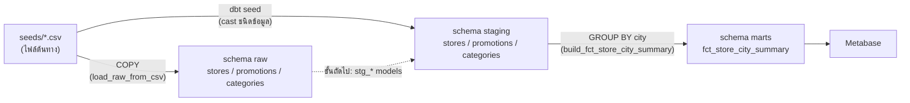
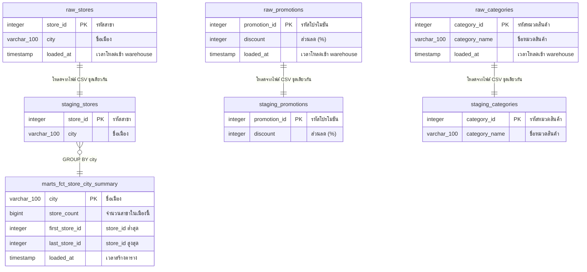

# โครงสร้างฐานข้อมูล (Database Design)

เอกสารนี้อธิบายโครงสร้างของ Data Warehouse ในโปรเจกต์นี้ — schema ทั้ง 3 ชั้น
ทุกตารางพร้อมชนิดข้อมูล และ ERD

เรื่องกฎการตั้งชื่อ ดูที่ [`naming_conventions.md`](naming_conventions.md)

---

## 1. ภาพรวม

warehouse คือ PostgreSQL 16 database ชื่อ **`dw`** แบ่งเป็น 3 schema ตามชั้นของข้อมูล

| ชั้น | schema | หน้าที่ | ใครเขียน | รูปแบบ |
| --- | --- | --- | --- | --- |
| 1 | `raw` | **landing zone** — รับข้อมูลดิบจากไฟล์ต้นทางตรง ๆ ไม่แปลงค่า เก็บ `loaded_at` ไว้ตรวจย้อนหลัง | Airflow task `load_raw_from_csv` (TRUNCATE + COPY) | table |
| 2 | `staging` | **ทำความสะอาด** — cast ชนิดข้อมูลให้ถูกต้อง บังคับ constraint ด้วย dbt test | dbt (`dbt seed`) | table |
| 3 | `marts` | **ตารางสำหรับวิเคราะห์** — aggregate แล้ว พร้อมให้ Metabase ใช้ | Airflow task `build_fct_store_city_summary` | table |

ทิศทางการไหลของข้อมูล



> **หมายเหตุสถานะปัจจุบัน** — ชั้น `staging` ตอนนี้สร้างด้วย `dbt seed` ซึ่งอ่านไฟล์
> CSV ต้นทางโดยตรงและ cast ชนิดข้อมูลตาม `_seeds.yml` ส่วน `raw` เป็น landing zone
> ที่เก็บสำเนาดิบพร้อม `loaded_at` ไว้ตรวจสอบ
>
> ขั้นถัดไปของโปรเจกต์คือเขียน dbt model `stg_seed__stores.sql` ฯลฯ ให้ `staging`
> อ่านจาก `raw` แทน (เส้นประในแผนภาพ) แล้ว `staging` จะต่อจาก `raw` เต็มรูปแบบ

---

## 2. ERD



> ชื่อ entity ในแผนภาพใช้ `_` แทน `.` (เช่น `raw_stores` = `raw.stores`) เพราะ Mermaid
> ไม่รองรับจุดในชื่อ entity และชนิด `varchar_100` หมายถึง `varchar(100)`

**ความสัมพันธ์ระหว่าง 3 entity หลัก** — `stores`, `promotions`, `categories` เป็นตาราง
lookup ที่**อิสระต่อกัน** ยังไม่มีตารางธุรกรรม (เช่น `sales`) มาเชื่อม จึงไม่มี foreign key
ระหว่างกัน เมื่อเพิ่มตารางธุรกรรมในอนาคต ทั้งสามตารางจะกลายเป็น dimension และ
เชื่อมด้วย `store_id` / `promotion_id` / `category_id`

---

## 3. Schema `raw`

landing zone — DDL อยู่ที่ [`../sql/create_raw_tables.sql`](../sql/create_raw_tables.sql)
รันซ้ำได้ (`CREATE TABLE IF NOT EXISTS`) และถูกเรียกทั้งตอน Postgres init ครั้งแรก
และทุกครั้งที่ DAG ทำงาน

ข้อมูลถูกเขียนด้วย `TRUNCATE` + `COPY` ในทรานแซกชันเดียว (full reload)

### 3.1 `raw.stores`

ข้อมูลดิบรายสาขา โหลดจาก `seeds/stores.csv` — 100 แถว

| คอลัมน์ | ชนิดข้อมูล | PK | Nullable | Default | คำอธิบาย |
| --- | --- | :-: | :-: | --- | --- |
| `store_id` | `integer` | ✔ | NOT NULL | — | รหัสสาขา มาจากไฟล์ต้นทาง |
| `city` | `varchar(100)` | | NOT NULL | — | ชื่อเมืองที่สาขาตั้งอยู่ (Mumbai, Pune, Delhi, Bangalore) |
| `loaded_at` | `timestamp` | | NOT NULL | `now()` | เวลาที่แถวนี้ถูกโหลดเข้า warehouse |

Primary key: `pk_raw_stores (store_id)`

### 3.2 `raw.promotions`

ข้อมูลดิบรายโปรโมชัน โหลดจาก `seeds/promotions.csv` — 50 แถว

| คอลัมน์ | ชนิดข้อมูล | PK | Nullable | Default | คำอธิบาย |
| --- | --- | :-: | :-: | --- | --- |
| `promotion_id` | `integer` | ✔ | NOT NULL | — | รหัสโปรโมชัน มาจากไฟล์ต้นทาง |
| `discount` | `integer` | | NOT NULL | — | ส่วนลดเป็นเปอร์เซ็นต์ จำนวนเต็ม (เช่น `24` = 24%) |
| `loaded_at` | `timestamp` | | NOT NULL | `now()` | เวลาที่แถวนี้ถูกโหลดเข้า warehouse |

Primary key: `pk_raw_promotions (promotion_id)`

### 3.3 `raw.categories`

ข้อมูลดิบรายหมวดสินค้า โหลดจาก `seeds/categories.csv` — 30 แถว

| คอลัมน์ | ชนิดข้อมูล | PK | Nullable | Default | คำอธิบาย |
| --- | --- | :-: | :-: | --- | --- |
| `category_id` | `integer` | ✔ | NOT NULL | — | รหัสหมวดสินค้า มาจากไฟล์ต้นทาง |
| `category_name` | `varchar(100)` | | NOT NULL | — | ชื่อหมวดสินค้า (`Cat_1` … `Cat_30`) |
| `loaded_at` | `timestamp` | | NOT NULL | `now()` | เวลาที่แถวนี้ถูกโหลดเข้า warehouse |

Primary key: `pk_raw_categories (category_id)`

---

## 4. Schema `staging`

สร้างด้วย `dbt seed` — ชนิดข้อมูลกำหนดจาก `column_types` ใน
[`../my_dbt_project/seeds/_seeds.yml`](../my_dbt_project/seeds/_seeds.yml)
และตรวจความถูกต้องด้วย `dbt test`

dbt สร้างตารางนี้แบบ full refresh ทุกครั้ง (`--full-refresh`) จึงไม่มี PK constraint
ในระดับฐานข้อมูล แต่บังคับด้วย **dbt test** `unique` + `not_null` แทน

### 4.1 `staging.stores`

| คอลัมน์ | ชนิดข้อมูล | PK (logical) | Nullable | dbt test | คำอธิบาย |
| --- | --- | :-: | :-: | --- | --- |
| `store_id` | `integer` | ✔ | NOT NULL (test) | `unique`, `not_null` | รหัสสาขา |
| `city` | `varchar(100)` | | NOT NULL (test) | `not_null` | ชื่อเมืองที่สาขาตั้งอยู่ |

### 4.2 `staging.promotions`

| คอลัมน์ | ชนิดข้อมูล | PK (logical) | Nullable | dbt test | คำอธิบาย |
| --- | --- | :-: | :-: | --- | --- |
| `promotion_id` | `integer` | ✔ | NOT NULL (test) | `unique`, `not_null` | รหัสโปรโมชัน |
| `discount` | `integer` | | NOT NULL (test) | `not_null` | ส่วนลดเป็นเปอร์เซ็นต์ |

### 4.3 `staging.categories`

| คอลัมน์ | ชนิดข้อมูล | PK (logical) | Nullable | dbt test | คำอธิบาย |
| --- | --- | :-: | :-: | --- | --- |
| `category_id` | `integer` | ✔ | NOT NULL (test) | `unique`, `not_null` | รหัสหมวดสินค้า |
| `category_name` | `varchar(100)` | | nullable | — | ชื่อหมวดสินค้า |

---

## 5. Schema `marts`

ตารางสำหรับวิเคราะห์ / ต่อ Metabase สร้างโดย task
`build_fct_store_city_summary` ใน DAG `dw_sample_pipeline`
(`DROP` แล้ว `CREATE TABLE AS` ทุกรอบ)

### 5.1 `marts.fct_store_city_summary`

จำนวนสาขาต่อเมือง — grain: **1 แถว = 1 เมือง** (4 แถว)

| คอลัมน์ | ชนิดข้อมูล | PK (logical) | Nullable | คำอธิบาย |
| --- | --- | :-: | :-: | --- |
| `city` | `varchar(100)` | ✔ | nullable | ชื่อเมือง (grain ของตาราง) |
| `store_count` | `bigint` | | nullable | จำนวนสาขาในเมืองนั้น (`COUNT(*)`) |
| `first_store_id` | `integer` | | nullable | `store_id` ต่ำสุดในเมืองนั้น (`MIN`) |
| `last_store_id` | `integer` | | nullable | `store_id` สูงสุดในเมืองนั้น (`MAX`) |
| `loaded_at` | `timestamp with time zone` | | nullable | เวลาที่สร้างตารางรอบล่าสุด (`CURRENT_TIMESTAMP`) |

ตารางสร้างด้วย `CREATE TABLE AS SELECT` ซึ่งไม่สืบทอด `NOT NULL` / PK จากต้นทาง
ทุกคอลัมน์จึงเป็น nullable ในระดับฐานข้อมูล ส่วน `city` เป็น PK เชิงตรรกะเพราะมาจาก
`GROUP BY city`

ค่าปัจจุบัน

| city | store_count | first_store_id | last_store_id |
| --- | --- | --- | --- |
| Mumbai | 31 | 4 | 98 |
| Pune | 27 | 1 | 96 |
| Bangalore | 21 | 8 | 99 |
| Delhi | 21 | 3 | 100 |

---

## 6. Database อื่นบน Postgres instance เดียวกัน

| database | ใครใช้ | หมายเหตุ |
| --- | --- | --- |
| `dw` | warehouse | schema `raw`, `staging`, `marts` — เนื้อหาของเอกสารนี้ |
| `airflow` | Airflow metadata | สร้างโดย `postgres/init/01_create_databases.sh`, ตารางสร้างโดย `airflow db migrate` |
| `metabase` | Metabase application data | สร้างโดย `postgres/init/01_create_databases.sh`, ตารางสร้างโดย Metabase เอง |

ไม่ควรไปแก้ `airflow` / `metabase` ด้วยมือ — เป็น metadata ของเครื่องมือ

---

## 7. คำสั่งตรวจโครงสร้าง

```powershell
# รายชื่อ schema
docker compose exec dw_postgres psql -U dw_user -d dw -c "\dn"

# ตารางทั้งหมดใน 3 ชั้น
docker compose exec dw_postgres psql -U dw_user -d dw -c "SELECT table_schema, table_name FROM information_schema.tables WHERE table_schema IN ('raw','staging','marts') ORDER BY 1,2;"

# โครงสร้าง + comment ของตารางเดียว
docker compose exec dw_postgres psql -U dw_user -d dw -c "\d+ raw.stores"

# comment ของทุกคอลัมน์ในชั้น raw
docker compose exec dw_postgres psql -U dw_user -d dw -c "SELECT c.table_name, c.column_name, c.data_type, c.is_nullable, pgd.description FROM information_schema.columns c JOIN pg_class cl ON cl.relname = c.table_name JOIN pg_namespace n ON n.oid = cl.relnamespace AND n.nspname = c.table_schema LEFT JOIN pg_description pgd ON pgd.objoid = cl.oid AND pgd.objsubid = c.ordinal_position WHERE c.table_schema = 'raw' ORDER BY 1, c.ordinal_position;"
```
